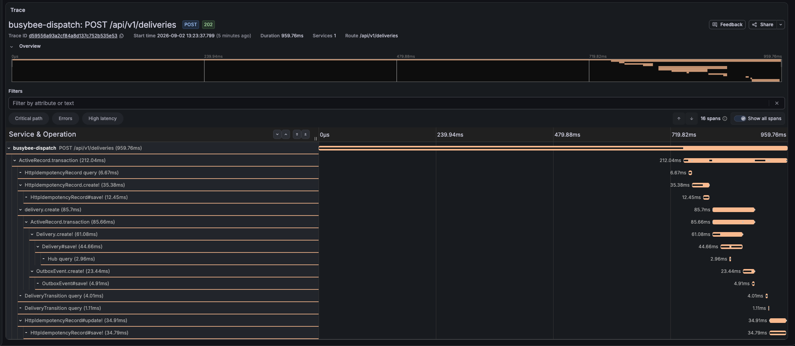

# OpenTelemetry instrumentation

BusyBee Dispatch exports traces, metrics, and logs to the Grafana LGTM service in
Compose. The instrumentation covers incoming Rails requests, Active Record, Redis,
Faraday, AWS SDK calls, Sidekiq jobs, Shoryuken message processing, and the main
delivery lifecycle operations.

## Example trace

The `happy-path` scenario produces a `POST /api/v1/deliveries` server span with the
`delivery.create` business operation and its database work as descendants.



Use the Tempo data source in Grafana Explore to find current traces:

```traceql
{ resource.service.name = "busybee-dispatch" }
```

The demo uses full trace sampling so exercised scenarios are available immediately.
LGTM retains its data in the `lgtm-data` Docker volume across normal Compose restarts.
